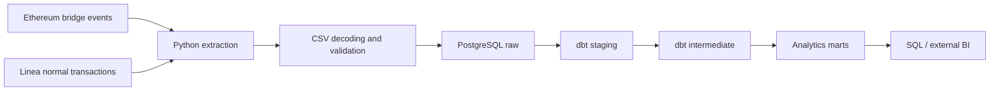

# Crypto Analysis — Linea Wallet Retention

**Do wallets keep using Linea after sending ETH from Ethereum?**

A data engineering and analytics project that turns on-chain bridge events and wallet transactions into explainable cohort, retention, and activity tables. Built with **Python · PostgreSQL · dbt · Docker**.

[Architecture](#architecture) · [Engineering decisions](#engineering-decisions) · [Run locally](#run-locally) · [Explore the marts](#explore-the-marts) · [Tests](#tests-and-verification)

## What this project demonstrates

- **API reliability:** retry and rate limiting, block-window splitting, resumable wallet checkpoints, and protection against publishing partial Linea extracts.
- **Analytics modeling:** a shared post-bridge transaction scope feeding staging, intermediate, and mart models.
- **Metric correctness:** late-starting wallets remain in retention, gaps break continuous retention, and incomplete calendar months have NULL rates.
- **Testable business rules:** actual model SQL is checked against small PostgreSQL fixtures, alongside Python extraction tests and dbt assertions.

The output is a PostgreSQL analytics warehouse for SQL exploration or an external BI tool. A dashboard application, scheduler, and live production deployment are not bundled.

## Project snapshot

| Item | Verified local snapshot |
| --- | --- |
| Analysis window | January 1–October 1, 2026, inclusive, UTC |
| Positive-ETH bridge events | 1,990 |
| Distinct bridge senders | 1,130 |
| Unique Linea transactions in the transformed cache | 15,738 |
| Latest verified dbt build | 11 models + 1 seed; all 53 dbt tests passed, October 16, 2026 |
| Python unittest suite | 20 cases, including 8 read-only PostgreSQL metric scenarios |

**Data status:** the cached Linea extraction is known to be incomplete. These counts describe the available dataset, not total network activity or a complete retention study. The repaired extractor must be rerun before reporting business conclusions; passing tests does not establish source completeness. Local datasets and build artifacts are not committed.

## Architecture



Both chains are queried through Etherscan V2: Ethereum chain ID `1`, Linea chain ID `59144`. Ethereum logs identify the observed bridge cohort; Linea transactions provide subsequent wallet activity.

| Layer | Responsibility | Example |
| --- | --- | --- |
| Extraction / transformation | Fetch, decode, filter positive-ETH sends, validate, and checkpoint | `src/extract/`, `src/transform/` |
| `raw` | Store transformed source records before dbt | `raw.etherscan_logs`, `raw.linea_transactions` |
| `analytics_staging` | Standardize fields and enforce the shared UTC window | `stg_linea_transactions` |
| `analytics_intermediate` | Assign cohorts/segments and define post-bridge activity once | `int_user_transactions`, `int_monthly_activity` |
| `analytics_marts` | Expose wallet profiles, retention, activity mix, and UTC sessions | `dim_users`, `fct_cohort_retention` |

The schemas above match the setup and SQL examples below.

## Engineering decisions

| Problem | Implementation | Why it matters |
| --- | --- | --- |
| An API error can look like an inactive wallet | Retry failures; record per-wallet status; publish the main Linea CSV only when every queried wallet succeeds | Missing requests are not silently classified as zero activity |
| Large wallet histories exceed an API result window | Split capped or timed-out block windows; cache completed wallets | A rerun can resume without restarting every wallet |
| Each mart could interpret activity differently | Centralize outgoing, strictly post-bridge transactions in `int_user_transactions` | Monthly activity, retention, buckets, and session tables share a definition |
| A later bridge is activity, but does not prove application usage | Separate general successful activity from classified non-bridge activity | Both questions can be analyzed without conflating them |
| Late starters and silent months distort retention | Keep the entire cohort denominator and generate observed calendar months | Late starters count, zero-activity months remain visible, and gaps break continuous retention |
| A partial month is not comparable to a full month | Preserve observed counts but return NULL rates until the month ends | October 1 is not treated as a complete October |

## What the metrics mean

A **user is an address**, not an identified person. Its cohort starts at the first positive-ETH send observed through the configured Ethereum-to-Linea contract. This is neither a verified first-ever bridge nor proof of successful delivery on Linea.

| Metric | Definition |
| --- | --- |
| General activity | A successful outgoing Linea transaction strictly after the first observed bridge send; includes later bridges |
| Classified non-bridge activity | General activity assigned to a recognized non-bridge bucket; unknown classifications are not assumed to be non-bridge |
| Month-0 activation | Share of the cohort active in its bridge calendar month; not a 7/30-day activation window |
| Monthly retention | Active addresses in relative month N / all addresses in the cohort and segment |
| Continuous retention | Addresses active in every month from 0 through N / the same cohort denominator |

Receiving funds alone does not count as active use. Failed attempts remain available for diagnostics but do not qualify as successful activity. Whales have **more than 10 ETH in total observed bridge volume**; other addresses are Retail.

Function-name buckets remain heuristic. Approvals are separate from swaps; unknown activity remains visible. ETH values are native ETH attached to transactions, not total token trading volume. See [the full metric specification](docs/metrics.md) for inactivity rules, scope, and field meanings.

## Run locally

The commands below use **PowerShell, Python 3.10/3.11**, and PostgreSQL. Docker Desktop is needed only when using the included PostgreSQL service. API access must support both requested chains and endpoints; a full extraction consumes API requests and may take time.

### 1. Install

```powershell
git clone https://github.com/phanhuy11d3-boop/Crypto-Analysis.git
cd Crypto-Analysis
python -m venv .venv
.\.venv\Scripts\Activate.ps1
pip install -r requirements.txt
```

### 2. Configure the environment and dates

Create `.env` in the repository root:

```dotenv
ETHERSCAN_API_KEY=your_etherscan_api_key
POSTGRES_HOST=127.0.0.1
POSTGRES_PORT=5434
POSTGRES_DB=linea_analytics
POSTGRES_USER=postgres
POSTGRES_PASSWORD=replace_with_a_local_password
```

`LINEASCAN_API_KEY` is optional and falls back to `ETHERSCAN_API_KEY`. An Infura key is only needed if using the optional RPC configuration.

Edit the dates in **one place**, `dbt/dbt_project.yml`:

```yaml
vars:
  extraction_start_date: '2026-01-01'
  extraction_end_date: '2026-10-01'
```

Python and dbt read the same values. The window includes both full UTC boundary days, implemented as `>= start` and `< midnight after end`. Changing the window requires refreshing the relevant extracted/loaded data; do not override only dbt's dates with `--vars`.

### 3. Start PostgreSQL and configure dbt

Start Docker Desktop, then run:

```powershell
docker compose up -d warehouse
docker compose ps warehouse
```

Wait until the service is healthy. Keep Docker running when querying from DBeaver. With the `.env` above, connect to **127.0.0.1:5434**, database **linea_analytics**. An existing PostgreSQL instance can be used instead.

Create the gitignored file `dbt/profiles.yml`:

```yaml
linea_analytics:
  target: local
  outputs:
    local:
      type: postgres
      host: "{{ env_var('POSTGRES_HOST', '127.0.0.1') }}"
      port: "{{ env_var('POSTGRES_PORT', '5434') | int }}"
      user: "{{ env_var('POSTGRES_USER', 'postgres') }}"
      password: "{{ env_var('POSTGRES_PASSWORD') }}"
      dbname: "{{ env_var('POSTGRES_DB', 'linea_analytics') }}"
      schema: analytics
      threads: 4
```

`src/run_dbt.py` loads `.env` before invoking dbt. The `analytics` target schema produces `analytics_staging`, `analytics_intermediate`, and `analytics_marts`; the reference seed goes into `analytics`. If changing the database name, update `dbt/models/staging/sources.yml` too.

### 4. Try a bounded API sample first

```powershell
python src/run_sample.py
```

This requests the first UTC day in the configured window and queries at most five eligible bridge senders. It writes CSVs and a summary to `data/raw/sample_<date>/`. It does not overwrite the main dataset or automatically load PostgreSQL. This is a small live API run, not a bundled offline dataset.

### 5. Run the full pipeline

```powershell
python src/extract/extract_logs_from_etherscan.py
python src/transform/transform_logs.py
python src/extract/extract_transactions_from_lineascan.py
python src/transform/transform_transactions.py
python src/load/load_to_database.py
python src/run_dbt.py build
```

Check that each command succeeds before continuing. If Linea extraction fails, rerun it to resume completed wallet checkpoints; do not load `.partial.csv` as a full dataset. The loader writes `raw` tables, and dbt builds/tests the downstream models. Retention tables use the data currently loaded, not a fresh API request.

## Explore the marts

Run in PostgreSQL database `linea_analytics`, for example through DBeaver:

```sql
-- Wallet profiles: counts refer to the available post-bridge observation window.
SELECT *
FROM analytics_marts.dim_users
ORDER BY post_bridge_tx_count DESC;

-- Observed counts remain visible for partial months; rates are NULL.
SELECT cohort_month, user_segment, months_since_bridge,
       cohort_size, active_users, non_bridge_active_users,
       retention_rate, non_bridge_retention_rate,
       cumulative_retention_rate, is_month_complete
FROM analytics_marts.fct_cohort_retention
ORDER BY cohort_month, user_segment, months_since_bridge;
```

| Mart | One row represents | Useful question |
| --- | --- | --- |
| `dim_users` | One cohort address | What activity has this address shown after its observed bridge send? |
| `fct_cohort_retention` | Cohort month × segment × relative month | Which cohorts return, including late starters? |
| `mart_activity_buckets` | Calendar month × activity bucket × segment × tier | What kinds of successful activity appear after bridge? |
| `mart_wallet_trading_sessions` | One address with observed successful post-bridge activity | Which UTC interval contains most of its activity? |

The last table keeps a historical name: it measures **Linea activity**, not necessarily trading or a user's geographic location. More queries: [all marts](sql/mart_queries.sql) · [raw sources](sql/raw_queries.sql).

## Tests and verification

Run the extraction and date-boundary tests without live API calls:

```powershell
python -m unittest discover -s tests -v
```

Eight PostgreSQL scenarios are skipped unless enabled. With a configured, running database:

```powershell
$env:RUN_DB_INTEGRATION='1'
python -m unittest discover -s tests -v
python src/run_dbt.py build
```

The PostgreSQL fixture tests run the **actual model SQL through read-only CTEs** without changing production tables. They check:

- pre-bridge and incoming-only transactions do not count as active use;
- later bridges count as general activity but not non-bridge activity;
- failed attempts do not make a wallet active;
- a late starter counts in its active month, even without month-0 activity;
- a missing month breaks continuous retention;
- complete inactive months have zero rates; partial months have NULL rates;
- approvals/multicalls are not automatically labeled swaps;
- UTC session counts use post-bridge Linea transactions.

The last verified local dbt build completed **65 nodes: 11 models, 1 seed, and 53 tests**. These are recorded local results, not a claim of automated CI or complete API coverage.

## Limitations and next steps

- **Complete the source refresh:** the existing cache is incomplete; re-extract with the repaired extractor before interpreting retention as a business finding.
- **Improve classification:** function names provide heuristics; contract-aware rules or execution evidence would improve confidence.
- **Scope remains bounded:** normal transactions only; internal transactions, full token-transfer histories, and L1-send/L2-delivery matching are outside this dataset.
- **First observed is not first-ever:** a wallet may have used Linea before the configured window.
- **Add presentation after validating the dataset:** a BI dashboard and defensible findings are the next deliverable, not currently bundled features.

<details>
<summary>Repository layout and optional SQLite inspection</summary>

```text
├── compose.yml            # PostgreSQL 16
├── dbt/
│   ├── macros/            # Shared UTC extraction window
│   ├── models/            # Staging → intermediate → marts
│   ├── seeds/             # Reference events
│   └── tests/             # Data and metric assertions
├── docs/metrics.md        # Full metric definitions
├── sql/                   # Exploration queries
├── src/
│   ├── extract/           # API clients, retry, checkpoints
│   ├── transform/         # Decoding, filtering, validation
│   ├── load/              # PostgreSQL and SQLite loaders
│   ├── utils/             # Shared configuration
│   ├── run_dbt.py         # dbt wrapper
│   └── run_sample.py      # Bounded live API sample
├── tests/                 # Extraction and model-SQL scenarios
└── requirements.txt
```

After preparing transformed bridge logs and the main Linea transaction cache, `python src/load/load_to_sqlite.py` creates `data/linea_analytics.sqlite` for local inspection. The dbt pipeline uses PostgreSQL. Credentials, local profiles, datasets, and generated artifacts are excluded from version control.

</details>

## Project background

This project builds on the original [Linea User Analytics](https://github.com/0xlong/linea_user_analytics) repository. This version focuses on extraction reliability, shared post-bridge activity rules, corrected retention logic, UTC observation windows, executable PostgreSQL scenarios, and reproducible local setup. The original foundation and the subsequent engineering changes are distinct contributions.
